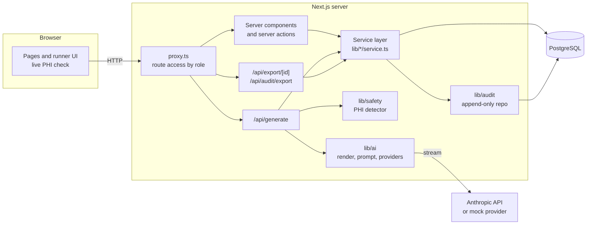
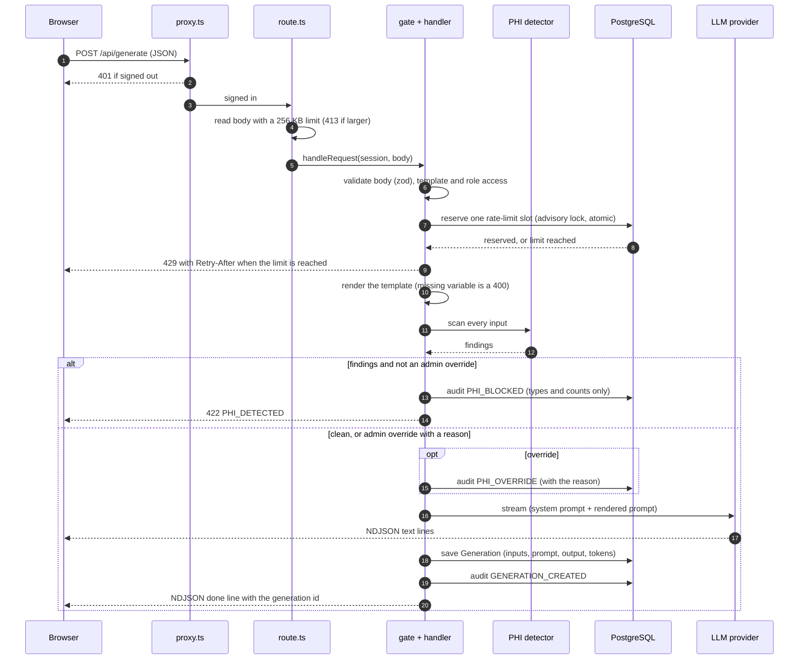
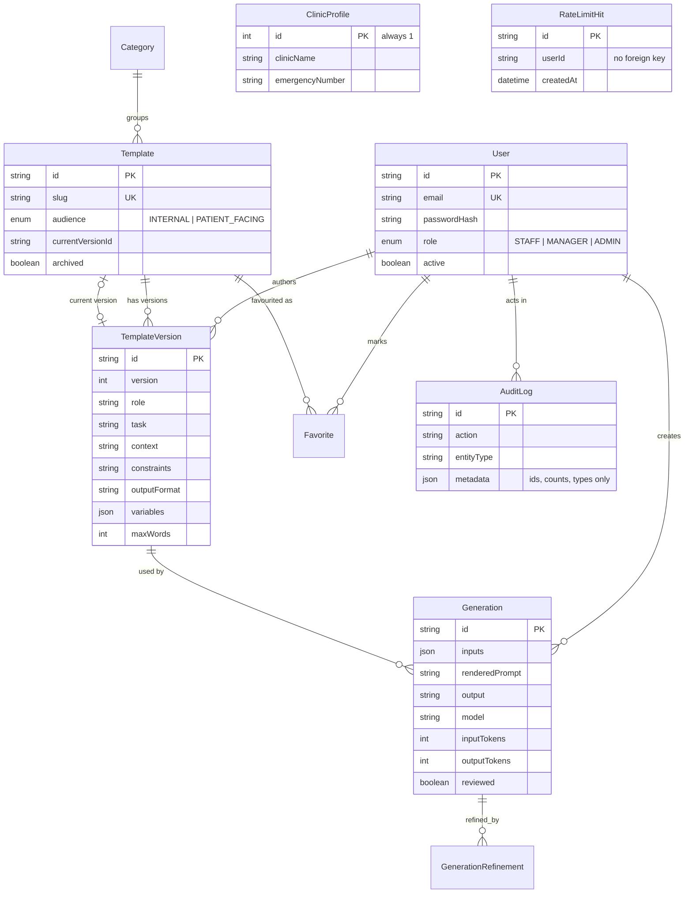

# Architecture

ClinicAssist is a single Next.js application (App Router) backed by PostgreSQL. There is no
separate API server: pages, server actions and a few route handlers all live in the same project.

## System overview

Layers, from the outside in:

- **`proxy.ts`** decides who may reach which path (`lib/auth/route-access.ts`). Signed-out API calls
  get a 401, signed-out pages redirect to `/login`, and a role that is too low gets a 403.
- **Services** (`lib/<area>/service.ts`) hold the rules (who sees which history, who may export,
  which settings a manager may change) and take their data access as an argument. Prisma
  repositories (`repo.ts`) implement those arguments; unit tests pass in fakes.
- **Security headers** are set for every response in `next.config.ts` (`lib/http/headers.ts`).

## Request flow for `/api/generate`

A body that contains `generationId` is a **refinement**; it goes through the same gate and PHI
check, and the model sees the original prompt, the answer and every earlier refinement. Saving a
refinement clears the review tick, because the text changed.

Copy and export of patient-facing drafts are blocked until the user records a review
(`reviewGenerationAction`). Export is also checked on the server (`/api/export/[id]`).

## Data model

`ClinicProfile` is a single row. `RateLimitHit` has no foreign key on purpose, so the limiter never
blocks deleting a user. Indexes sit on every foreign key and on `createdAt`. The full field list is
in `prisma/schema.prisma`.

## Audit log

`lib/audit/repo.ts` exposes `create` and read queries only; there is no update, delete or upsert
anywhere in the application, and a unit test asserts it. `lib/audit/sanitize.ts` is the last line
of defence: it drops keys that look like raw content or secrets (inputs, outputs, prompts, text,
passwords, tokens, emails), caps string length and nesting, and runs the PHI redactor over any
string that slips through, so a draft, an email address or a phone number cannot end up in the log. Actions are listed in
`lib/audit/actions.ts`.

## Rate limit

Each accepted generate or refine request inserts one `RateLimitHit`. The count and the insert run in
one transaction under `pg_advisory_xact_lock(hashtext(userId))`, so concurrent requests from one
user are serialised and cannot slip past the limit. A test fires parallel reservations at the real
database and checks that exactly `limit` succeed.

## Providers

`lib/ai/providers` has a mock (deterministic, no network) and an Anthropic provider (streaming). The
choice comes from `LLM_PROVIDER`; the Anthropic provider falls back to the mock when no key is set.
